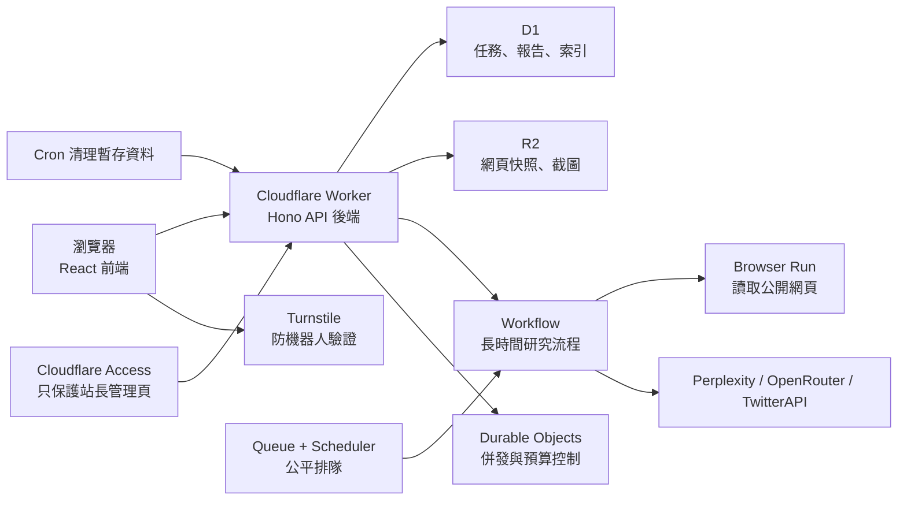

# Skill Reverse 系統架構

本文件描述正式站 `https://skill-reverse.vibeencode.dev` 的系統邊界、資料流、權限與維運方式。這是一個 Cloudflare 全棧應用，不需要另外串接 Supabase 才能擁有後端。

## 一張圖看懂



Cloudflare 提供的是執行平台和託管服務；`worker/`、`migrations/`、`src/` 與 `wrangler.jsonc` 才是把服務組裝成產品的應用程式。

## 各層責任

| 名詞 | 在本專案的責任 | 主要位置 |
|---|---|---|
| React / Vite | 畫面、路由、表單、公開看板與報告閱讀 | `src/` |
| Worker / Hono | API、權限、輸入驗證、資料讀寫、靜態資產路由 | `worker/index.ts` |
| D1 | jobs、reports、來源索引、職業資料與 provider ledger | `migrations/` |
| R2 | Browser Run 抓回的 markdown 與 screenshot | `skill-reverse-artifacts` |
| Workflow | 可重試、可恢復的多階段 AI 研究管線 | `worker/workflow.ts` |
| Queue / Durable Objects | 全站排隊、每人限制、每日預算與一致性 | `worker/durable.ts` |
| Turnstile | 避免匿名訪客大量消耗付費 API | `worker/security.ts` |
| Cloudflare Access | 只允許 owner 進入 `/admin` 與管理 API | `worker/access.ts` |
| Wrangler binding | Worker 與 D1、R2、Workflow 等資源的連線 | `wrangler.jsonc` |

官方背景資料：[Workers 全棧應用](https://developers.cloudflare.com/workers/static-assets/routing/full-stack-application/)、[D1 Worker API](https://developers.cloudflare.com/d1/worker-api/)、[R2 Worker API](https://developers.cloudflare.com/r2/get-started/workers-api/)、[Workflows](https://developers.cloudflare.com/workflows/)。

## 一次研究如何流動

1. 訪客輸入公開 HTTPS URL。
2. 前端查詢公開 archive，顯示相同來源最近的既有報告，但不會取代新研究。
3. `POST /api/jobs` 驗證 URL、職業、Turnstile、匿名 session 配額與全站預算。
4. job 先寫入 D1，`publication_status=unpublished`，再送入 Queue。
5. Scheduler 按全站和單一 actor 的併發上限啟動 Workflow。
6. Workflow 透過 Browser Run 抓來源，呼叫研究 provider，組成證據圖與報告。
7. 後端以完整繁中定稿產生英文版，驗證兩者的 ID、證據關係、分數與結構完全一致。
8. D1 以同一批次寫入來源索引、雙語 report bundle，並把 job 切成 `completed + published`；不發布單語半成品。
9. 公開 History 只讀取 `completed + published`，不依賴 cookie。
10. 同一 URL 再送一次會建立另一個 job/report，讓不同時間的結果並存。

## 排隊、重試與免費方案容量

- Queue 訊息只包含 job ID。一般成功工作約消耗寫入、讀取、刪除三次 operations；免費方案每日 10,000 operations、訊息保留 24 小時。consumer 成功寫入 Scheduler 後便 ack，因此 Scheduler 內的等待時間不受 24 小時限制。
- `ResearchScheduler` 是全站單例 SQLite-backed Durable Object。預設全站同時 2 筆、每個 actor 1 筆、每個 actor 最多 10 筆未完成；alarm 每分鐘核對 D1 與 Workflow 狀態。
- Workflow 的 provider step 總 attempts 為 2。timeout、429、5xx、空白、截斷與 schema 不完整會自動重試一次；認證、輸入與確定不可恢復的錯誤使用 `NonRetryableError`。
- Queue transport 失敗最多重試三次，再送到 DLQ。DLQ 只會將仍為 `queued` 的工作標成最終失敗，避免延遲的重複訊息誤殺已開始的 Workflow。
- Workflows 免費方案最多 100 個 running instances；本應用主動限制為 2。免費方案每 step 10 ms CPU、每 instance 50 個外部 subrequests、完成狀態保存三天，因此人工 checkpoint restart 只在保留期內可用。

官方限制：[Queues pricing](https://developers.cloudflare.com/queues/platform/pricing/)、[Queues limits](https://developers.cloudflare.com/queues/platform/limits/)、[Durable Objects pricing](https://developers.cloudflare.com/durable-objects/platform/pricing/)、[Workflows limits](https://developers.cloudflare.com/workflows/reference/limits/)。

## 公開、匿名與權限不是同一件事

- 公開 History 是全站共享成果庫，任何瀏覽器、裝置或網域都讀到相同結果。
- `sr_actor` cookie 仍存在，但只用於付費工作配額、執行中任務和重試控制；它不是帳號，也不決定公開 History。
- published 報告與可用的 R2 證據永久保留。
- hidden 報告在 History、報告 URL、job URL 與證據 URL 都回傳 404。
- 只有 Cloudflare Access 驗證過的 owner 能 hide、restore 或永久 delete。
- 永久 delete 會刪除 job、report、source_artifacts 和 `jobs/{jobId}/` 下的 R2 物件。

## 資料生命週期

`publication_status` 有三個狀態：

- `unpublished`：排隊、執行中、失敗或尚未完成。
- `published`：完整報告已公開；不受 report/artifact TTL 清除。
- `hidden`：保留資料與證據，但所有公開讀取均隱藏。

Cron 只會刪除過期且非 published 的 job，以及非 published job 的舊 R2 內容。`REPORT_TTL_DAYS` 與 `ARTIFACT_TTL_DAYS` 因此只控制暫存或失敗資料。

## 站長管理設定

1. 在 Cloudflare Zero Trust 建立 self-hosted Access application。
2. 保護：
   - `skill-reverse.vibeencode.dev/admin*`
   - `skill-reverse.vibeencode.dev/api/admin/*`
3. Policy 只 allow owner email；可使用 email one-time PIN 或既有 identity provider。
4. 將 team domain 和 application AUD 透過 `pnpm setup:prod` 存成 Worker secrets：
   - `CF_ACCESS_TEAM_DOMAIN`
   - `CF_ACCESS_AUD`
   - `CF_ACCESS_ALLOWED_EMAIL`
5. Worker 會驗證 `Cf-Access-Jwt-Assertion` 的簽章、issuer、audience、有效期；設定缺失時管理 API fail closed。

不要只依賴 Access dashboard route。Worker 端驗證可避免從 `workers.dev` 原始網址繞過管理保護。

## Migration、部署與備份

一般驗證：

```bash
pnpm typecheck
pnpm test
pnpm build
```

第一次套用永久 archive migration 前：

```bash
pnpm backup:prod
pnpm deploy
```

也可使用：

```bash
pnpm release
```

`backup:prod` 會在 migration 前把遠端 D1 的持久資料表匯出，並以舊、新 schema 都具備的 completed report 條件記錄 R2 參考 key，寫入 gitignored 的 `.backups/<timestamp>/`。Cloudflare D1 export 無法匯出 FTS5 virtual table，因此 `occupations_fts*` 會明確排除；它們是由 `occupations` 重建的搜尋索引，不是唯一資料。`deploy` 只允許 `codex/cloudflare-skill-reverse` 執行，套用 migration 後會先以和應用程式相同的 URL 規則精確回填 `target_key`，才部署 Worker。功能分支使用 `pnpm preview:upload`，只上傳 preview version，不變更 D1。完成後應複製備份到 owner 控制、Cloudflare 以外的位置。D1 另有 [Time Travel](https://developers.cloudflare.com/d1/platform/release-notes/)，但不應取代獨立備份。

舊報告補上遊戲化畫像時，先備份，再執行 `pnpm db:backfill-game-profiles:remote -- --dry-run`。確認零失敗後拿掉 `--dry-run`。回填會保留分享 opt-in，並在零失敗時寫入 `app_meta.game_profile_backfill_v1_1`。

恢復前先建立當下備份；D1 restore 或 import 會改變正式資料。R2 還原時依 `published-r2-inventory.txt` 對照 D1 reference，避免把不屬於 published report 的暫存物件公開。

## 常見問題

### 換網域後 History 是空的

舊版 History 以 host-only `sr_actor` cookie 和 `actor_hash` 過濾，因此換網域會被當成新訪客。新版公開 archive 不再使用 cookie 過濾。先檢查：

1. `/api/health` 的 database schema 是否為 8，並核對 `version.id` 是否為預期部署。
2. D1 completed jobs 是否有 `publication_status='published'`。
3. `/api/history` 是否不帶 cookie 也能回傳相同 items。

### 報告存在但公開 URL 是 404

依序檢查 job 的 `status`、`publication_status` 和 `report_id`。公開讀取需要 `completed + published + report_id`。

### 管理頁回傳 503

代表 `CF_ACCESS_TEAM_DOMAIN`、`CF_ACCESS_AUD` 或 `CF_ACCESS_ALLOWED_EMAIL` 尚未設定。管理 API 刻意 fail closed，不影響公開站。

### 何時才需要 Supabase

目前不需要。只有在產品加入公開帳號、複雜 row-level permissions、強依賴 Postgres 生態，或 D1 單庫容量／查詢吞吐逼近限制時，再評估 Postgres/Supabase。不要同時維護 D1 與 Supabase 兩套主要資料來源。
