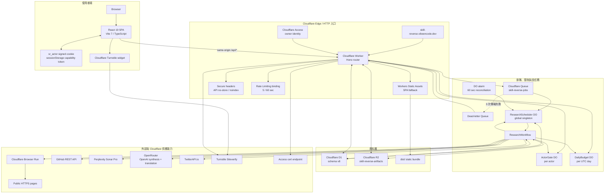
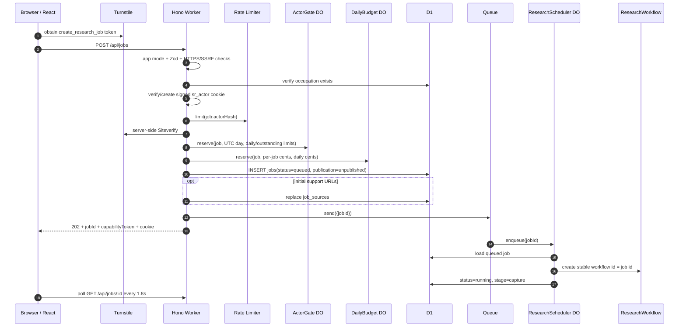
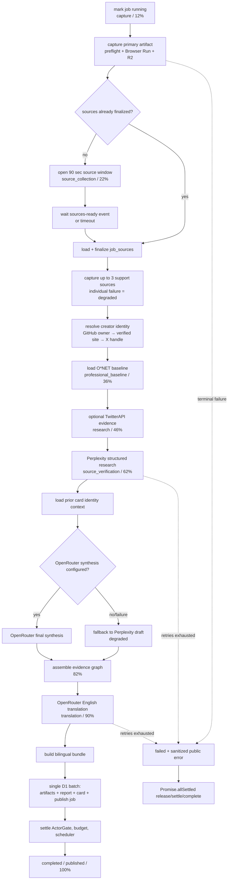
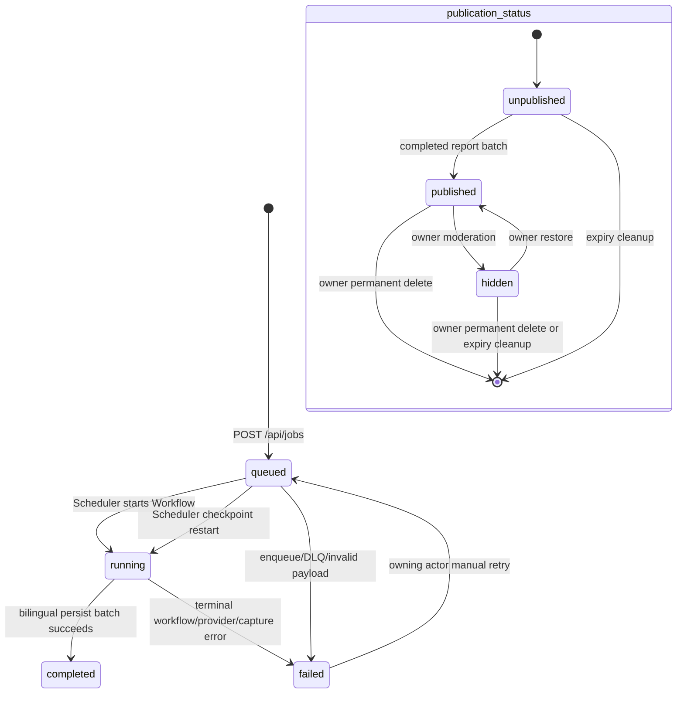
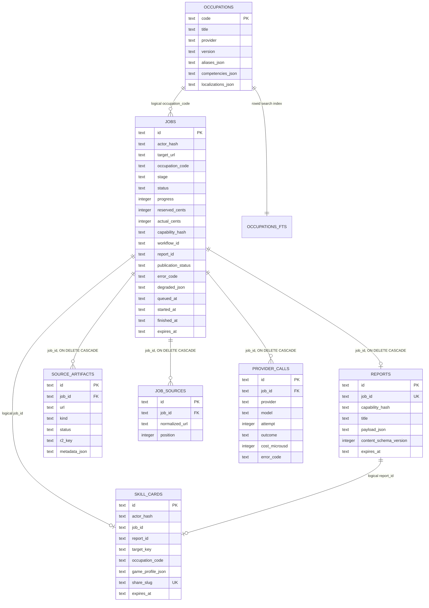
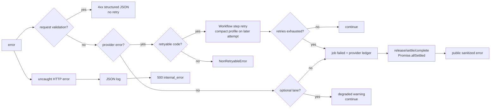

# Skill Reverse 完整系統架構與處理流程

> 本文件是程式碼導向的深度技術參考。高階維運說明仍放在
> [ARCHITECTURE.md](./ARCHITECTURE.md)。本文內容以目前 repository 的
> `src/`、`worker/`、`migrations/`、`scripts/`、`wrangler.jsonc` 為準。

## 1. 系統目的與邊界

Skill Reverse 接受一個公開 HTTPS URL 與一個 O*NET 職業視角，擷取來源、辨識創作者、
執行結構化研究與證據整理，最後發布繁中／英文雙語報告及六維遊戲化畫像。

系統是單一 Cloudflare 全棧應用：

- 瀏覽器只負責 SPA、表單、輪詢、報告呈現與 Turnstile widget。
- Cloudflare Worker 是唯一 HTTP API 與靜態資產入口。
- D1 是持久狀態的主資料庫。
- Queue 與 `ResearchScheduler` Durable Object 將短 HTTP request 與長時間研究解耦。
- Workflow 執行可重試、可恢復的研究管線。
- R2 保存來源文字快照與 screenshot。
- Browser Run、Perplexity、OpenRouter、TwitterAPI.io 是外部擷取／模型供應商。
- Cloudflare Access 只保護 owner 管理介面與管理 API。

不在本系統內的能力：

- 沒有登入帳號或跨裝置身份系統。
- 沒有 Supabase、Postgres、Redis 或獨立 application server。
- 沒有 WebSocket／SSE；前端以 HTTP polling 取得工作進度。
- 沒有 background worker process；所有非同步處理都在 Cloudflare 平台內。

## 2. 全部架構圖



## 3. 開發框架與 repository 分層

| 層 | 技術 | 版本／用途 | 主要位置 |
|---|---|---|---|
| UI | React | 19.2，SPA 與元件狀態 | `src/` |
| Build | Vite | 7，前端建置與本地伺服器 | `vite.config.ts` |
| Cloudflare local integration | `@cloudflare/vite-plugin` | 本地 Worker、bindings 與 assets 整合 | `vite.config.ts` |
| API | Hono | 4.11，routing、middleware、JSON response | `worker/index.ts` |
| Validation | Zod | 3.24，request 與模型結構驗證 | `worker/schema.ts` |
| Runtime | Cloudflare Workers | Node compatibility v2，compat date `2026-07-28` | `wrangler.jsonc` |
| Database | Cloudflare D1 / SQLite | 工作、報告、來源、供應商 ledger、卡片 | `migrations/` |
| Orchestration | Cloudflare Queues + Workflows | 排隊、DLQ、可重試研究步驟 | `worker/index.ts`, `worker/workflow.ts` |
| Concurrency | SQLite-backed Durable Objects | actor 限制、每日預算、全站排程 | `worker/durable.ts` |
| Object storage | Cloudflare R2 | markdown snapshots、PNG screenshots | `worker/services.ts` |
| Capture | Cloudflare Browser Run | 公開網頁 snapshot | `worker/services.ts` |
| Bot protection | Turnstile | browser widget + server-side Siteverify | `src/components/Turnstile.tsx`, `worker/security.ts` |
| Admin auth | Cloudflare Access | JWT 驗證、owner allowlist | `worker/access.ts` |
| Tests | Vitest + Workers pool | unit、binding、bootstrap、bilingual tests | `test/`, `vitest.config.ts` |
| Package manager | pnpm | 10.31 workspace | `package.json`, `pnpm-workspace.yaml` |
| Runtime baseline | Node.js | `>=22`，repository 預期 Node 24 | `package.json`, `.node-version` |

### 3.1 程式碼責任

```text
src/
  App.tsx                    SPA route、API helper、job polling
  LocaleContext.tsx          zh-TW / en URL 與 UI locale
  bilingual.ts               雙語 report / game profile bundle
  components/                表單、進度、報告、history、collection、admin
  types.ts                   前後端共用 domain types

worker/
  index.ts                   Hono API、middleware、Queue consumer、Cron
  workflow.ts                長時間研究主流程
  durable.ts                 ActorGate、DailyBudget、ResearchScheduler
  services.ts                capture、外部 provider、報告組裝
  security.ts                actor cookie、SSRF 基線、Turnstile
  access.ts                  Cloudflare Access JWT 驗證
  provider-ledger.ts         provider error taxonomy、成本 ledger
  schema.ts                  request/model/translation Zod schemas
  occupations.ts             O*NET 查詢與 localization
  job-sources.ts             補充來源正規化與選取
  publication.ts             target key 與 history cursor
  report-compat.ts           舊 report 升級
  game-profile.ts            六維畫像計算
  game-identity.ts           四字 identity 命名與 motif

migrations/                  D1 schema v1 → v8
scripts/                     local setup、bootstrap、doctor、backup、deploy、backfill
wrangler.jsonc               Cloudflare bindings、routes、limits、cron、observability
```

## 4. HTTP request 處理總覽

### 4.1 Worker routing 順序

所有 request 都先進 `worker/index.ts`：

1. `secureHeaders` 套用 CSP、frame、MIME、referrer 與 cross-origin headers。
2. `/api/*` response 強制 `Cache-Control: no-store` 與
   `X-Robots-Tag: noindex, nofollow`。
3. `/api/admin/*` 先執行 Worker 端 Cloudflare Access JWT 驗證。
4. Hono route 執行 request validation、authorization、D1／binding 操作。
5. 未捕捉例外進入全域 `app.onError`：
   - 以 JSON log 記錄 `event=request_error`、path、message。
   - production 只回固定 `internal_error`，不洩漏內部訊息。
6. 非 API request 交給 Workers Static Assets。
7. GET 且接受 HTML 的 404 會 fallback 到 `/`，由 React SPA 自行 routing。

### 4.2 前端 request 行為

- `App.tsx` 的 `api()` 將非 2xx response 轉成 `Error`，優先採用
  `body.error.message`。
- 工作頁每 1.8 秒 `GET /api/jobs/:id`。
- `completed + reportId` 時以 `replaceState` 導向 `/reports/:id`。
- `failed` 時停止 polling，顯示 sanitized public error 與 retry 狀態。
- History 的個人研究狀態每 3 秒更新。
- occupation autocomplete 有短 debounce。
- route 切換、browser back/forward 會清除既有 job poll timer。
- 沒有 request-level retry library；UI request 失敗由頁面 error state 或使用者重試處理。

### 4.3 API 分類、權限與副作用

| Method / path | 存取範圍 | 主要讀寫 | 成功狀態 | 常見顯式錯誤 |
|---|---|---|---|---|
| `GET /api/config` | public | env | 200 | 全域 500 |
| `GET /api/occupations` | public | D1 occupations（LIKE search） | 200 | 400 invalid locale；DB 失敗時 degraded fallback |
| `POST /api/jobs` | public + Turnstile + signed actor | DO、D1、Queue | 202 | 400 input/URL/Turnstile；429 limits；503 locked/budget |
| `GET /api/jobs/:id` | public by opaque ID | D1 | 200 | 404 missing/hidden |
| `GET /api/my-jobs` | actor cookie | D1 | 200 | 無 session secret 時回空集合 |
| `POST /api/jobs/:id/retry` | owning actor + Turnstile | DO、D1、Queue | 202 | 400/404/409/429/503 |
| `PUT /api/jobs/:id/sources` | owning actor | D1、Workflow event | 200 | 400/404/409/503 |
| `GET /api/history` | public | D1 reports/jobs | 200 | 400 locale/cursor/target |
| `GET /api/collection` | actor cookie | D1 | 200 | 無 session secret 時回空集合 |
| `DELETE /api/cards/:id` | owning actor | D1 | 204 | 404/503 |
| `POST /api/cards/:id/share` | owning actor | D1 | 200 | 404/503 |
| `GET /api/public/cards/:slug` | public by slug | D1 | 200 | 400 locale；404 |
| `POST /api/setup/smoke` | setup capability header | DO、D1、Queue | 202 | 401/503/429 |
| `GET /api/reports/:id` | public published report | D1 | 200 | 400 locale；404；409 upgrade required |
| `GET /api/reports/:reportId/artifacts/:sourceId` | public published report | D1、R2 | 200 stream | 404 |
| `GET /api/admin/reports` | Access owner | D1 | 200 | 400；401；503 |
| `PATCH /api/admin/reports/:id` | Access owner | D1 | 200 | 400；401；404；503 |
| `DELETE /api/admin/reports/:id` | Access owner | D1、R2 | 204 | 401；404；503 |
| `GET /api/health` | public summary | D1/env | 200 | response 內 `ok=false` |
| `GET /api/health?deep=1` | public；setup capability 才揭露 deep checks | 所有 bindings | 200 | 各 check 以 `ok=false` 表示 |
| `/admin`, `/admin/*` | Access owner | Assets | HTML | 401/503 |
| `GET /favicon.ico` | public | 無 | 204 | 無 |
| other non-API | public | Assets | asset / SPA | 404 |

實際 Hono static routes 是 `GET /admin`、`GET /admin/*`、`GET /favicon.ico`，
最後再由 `ALL *` fallback 處理其餘 method/path。

注意：

- `capabilityToken` 建立後存入前端 `sessionStorage`，後端只保存 SHA-256 hash；
  目前 API 沒有用 token 做讀取授權。它不是現行 access boundary。
- `GET /api/jobs/:id` 依不可猜測 UUID 提供狀態；只有 `hidden` 強制 404。
- published report、history 與公開 artifact 是產品設計上的公開資料。
- actor cookie 只控制 quota、個人 collection、補來源與 retry，不是帳號。

## 5. 建立研究 request：完整 sequence



### 5.1 驗證與 admission 順序

`POST /api/jobs` 依序執行：

1. `resolveAppMode`：
   - `APP_MODE=demo` → demo。
   - `SETUP_COMPLETE=true` → public。
   - 其他 → locked，回 `503 setup_required`。
2. Zod：
   - `targetUrl` 為 HTTPS URL，最長 2048。
   - `supportUrls` 最多 8 個。
   - `occupationCode` 必須符合 O*NET code 格式。
   - Turnstile token 必填。
3. URL 基線安全檢查：
   - HTTPS only。
   - 禁止 user/password。
   - 只允許預設 443 port。
   - 阻擋常見 metadata、localhost、`.local`、`.internal`、private IPv4。
4. D1 驗證 occupation 存在。
5. 解析或建立 `sr_actor`：
   - UUID + HMAC-SHA256 signature。
   - `HttpOnly; Secure; SameSite=Lax; Max-Age=30d`。
   - DB 與 DO 只保存 SHA-256 actor hash。
6. Rate Limiter：同 actor 建立工作 60 秒最多 5 次。
7. Turnstile Siteverify：
   - 傳 token、`CF-Connecting-IP`、idempotency key。
   - production 核對 hostname 與 action。
8. `ActorGate.reserve`：
   - 預設每日 20 個 accepted jobs。
   - 預設最多 10 個 outstanding jobs。
9. `DailyBudget.reserve`：
   - 每 job 預留 50 cents。
   - 每 UTC day 預設總上限 500 cents。
10. D1 寫入 queued job，再送 Queue。

若 D1 或 Queue enqueue 失敗：

- rollback actor reservation。
- release daily budget reservation。
- 優先刪除剛建立的 job。
- 若刪除也失敗，將仍為 queued 的 job 標成
  `failed / queue_enqueue_failed`。
- 例外交給全域 500 handler。

## 6. Queue、Scheduler 與 Workflow

### 6.1 Queue transport

Queue message 只包含：

```json
{ "jobId": "uuid" }
```

production queue 設定：

- main queue：`skill-reverse-jobs`。
- batch size：10。
- batch timeout：2 秒。
- max retries：3。
- retry delay：10 秒。
- consumer max concurrency：1。
- DLQ：`skill-reverse-jobs-dlq`。

consumer 行為：

- 空或非法 message 直接 ack。
- main queue 將 job 冪等加入全站 `ResearchScheduler`。
- 成功加入 scheduler 後 ack；長時間等待不再受 Queue retention 控制。
- handler 失敗時 `retry(10s)` 並記錄 `queue_admission_failed`。
- DLQ 只將「仍是 queued」的 job 標成 `queue_delivery_failed`，
  防止延遲 duplicate 誤殺已開始或已完成的工作。
- DLQ 最終失敗時釋放 ActorGate、DailyBudget 與 Scheduler 狀態。

### 6.2 ResearchScheduler Durable Object

單例名稱固定為 `global`，SQLite-backed storage 保存：

```ts
{
  pending: [{ jobId, actorHash, queuedAt }],
  active: {
    [jobId]: { jobId, actorHash, queuedAt, workflowId, startedAt }
  },
  leaseUntil,
  lastReconciledAt
}
```

排程規則：

- 全站同時執行預設 2 筆，最多可配置到 20。
- 同 actor 同時執行預設 1 筆，最多可配置到 10。
- pending 先依 `queuedAt`、再依 `jobId` 排序。
- 如果隊首 actor 已滿，會找下一個可執行 actor，避免單一 actor 阻塞全站。
- Workflow ID 固定等於 job ID，讓 create 與 D1 update 中斷時可復原既有 instance。
- 若 retry job 已有 terminal workflow，scheduler 從
  `reverse research with structured evidence` checkpoint restart。
- 有 pending 或 active 時，每 60 秒設 alarm。

reconciliation：

- D1 job 已 completed/failed → 從 active 移除並 settle gates。
- Workflow terminal，但 D1 仍 running →
  `failed / workflow_completion_lost`，保存 workflow error，釋放 gates。
- 讀取 Workflow status 暫時失敗 → warning log，保留 active，下一次 alarm 重試。

### 6.3 ActorGate 與 DailyBudget

`ActorGate` 每個 actor hash 一個 instance：

- `reserve` 是冪等的。
- `release` 只移除 outstanding，不退還每日 accepted count。
- `rollback` 用於 admission/queue 失敗；同一天會退回 accepted count。
- 換日只重設 `jobsToday`，仍保留跨日 outstanding jobs。

`DailyBudget` 每個 UTC `YYYY-MM-DD` 一個 instance：

- 同 job reservation 冪等。
- admission 以 `actual + reserved + newReservation <= dailyLimit` 判斷。
- `settle` 以 job 的累積 actual cost 計帳，避免重複 settle。
- `release` 只取消 reservation，不增加 actual。

重要語意：`JOB_USD_LIMIT` 目前是 admission reservation 與手動 retry 判斷，
不是 provider request 中途的硬停止器。研究執行期間沒有每一步重新比較
`actual_cents` 與 `reserved_cents`。

## 7. ResearchWorkflow 完整步驟



### 7.1 擷取來源

每個 URL 在 Browser Run 前先：

1. `assertSafePublicUrl`。
2. 以普通 `fetch`、`Range: bytes=0-2047`、manual redirect preflight。
3. 每一個 redirect 重新檢查 URL，最多 6 hops。
4. 拒絕 declared content length 超過 10 MB。
5. 只允許 HTML、XHTML、plain text。
6. 4xx/5xx 視為 preflight failure。

Browser Run：

- action：`snapshot`。
- navigation：`networkidle2`，timeout 30 秒。
- viewport：1440 × 1000。
- 拒絕 media 與 font。
- markdown 最多保留 60,000 字元。
- 無可讀內容視為失敗。
- markdown 寫入 `jobs/{jobId}/source-{index}.md`。
- screenshot 若存在，寫入相同 prefix 的 `.png`。
- GitHub repository URL 同時呼叫 GitHub REST API，保存 stars、forks、
  watchers、owner type、pushed time；失敗不阻塞。

擷取 retry／降級：

- primary capture 的 Workflow step 設定 2 次 retry、10 秒 linear delay。
- support capture step 設定 1 次 retry，但 step 內每個 URL 自己 catch；
  單一來源失敗只加入 `degraded`。
- creator profile/site capture 失敗只加入 `degraded`。

### 7.2 補充來源視窗

- primary capture 後開啟 90 秒 window。
- owning actor 可覆寫最多 8 個 URLs，或 `finalize=true` 提早結束。
- finalize 先以 conditional D1 update claim window，再 replace `job_sources`。
- replace 失敗會將 `sources_finalized_at` rollback。
- 若 Workflow 已建立，Worker 發 `sources-ready` event。
- event 傳送失敗只 warning；Workflow timeout 後仍會直接從 D1 讀最終來源。
- `selectCaptureSources` 去重並最多選取 3 個高價值來源。

### 7.3 創作者與 social provenance

GitHub target：

1. 解析 repository owner。
2. capture `github.com/{owner}`。
3. 從 verified-domain 區段找官方網站。
4. capture 官方網站並從第一方 HTML 找 X handle。
5. organization/team 是合法 creator，不自動把 contributor 當作者。

TwitterAPI.io：

- 只在有 key 且第一方鏈結確認 handle 時執行。
- 搜尋 repository/product keyword、`design`、`workflow`。
- 每 query 最多讀 40，總共去重後最多 120 posts。
- 無 key、無 handle、零結果、provider error 都是非阻塞 degraded。
- 估算成本以 post 數量加入 job cost。

### 7.4 Perplexity research

- endpoint：`/chat/completions`。
- model：`sonar-pro`。
- search context：low。
- temperature：0.1。
- response：strict JSON schema。
- full profile 最多 6,000 tokens；retry 改 compact profile，最多 4,500。
- source markdown 截斷：full 12,000／source，compact 6,000／source。
- 來源內容明確當作 untrusted evidence，避免 prompt injection。
- Zod 再驗證 research draft。
- creator kind/name/handle 由程式覆寫，模型不能改變第一方 identity。

### 7.5 OpenRouter synthesis 與 translation

synthesis：

- model 由 `OPENROUTER_SYNTHESIS_MODEL` 決定，預設
  `openai/gpt-5.6-terra`。
- reasoning effort low，reasoning text 不回傳。
- strict JSON schema，full 5,000／compact 4,000 max tokens。
- Zod 驗證 claim score、identity candidate 數量與唯一性。
- OpenRouter 未設定或 synthesis 最終失敗時，使用 Perplexity draft 組成報告，
  並加入 degraded。

translation：

- 使用相同 OpenRouter model。
- 將完成的繁中 report 當資料，只翻譯 user-facing text。
- strict schema，max 5,000 tokens。
- 程式逐項核對 framework steps、aliases、competencies、observations、
  claims、professional delta、adoption、caveats、degraded 的陣列長度。
- ID、evidence relationship、score、URL、來源與結構沿用原報告。
- translation 沒有 fallback；最終失敗會使整個 job failed，避免發布單語半成品。

### 7.6 evidence graph 的程式保護

- Browser Run 直接擷取 → `verified_at_retrieval`。
- provider citation 未直接擷取 → `inherited`。
- `verified` claim 沒有已擷取第一方 URL → 降成 `supported_inference`。
- claim 沒有 evidence IDs → 降成 `plausible`。
- `missing_but_expected` 若 rationale 沒說明「為何理應可觀察」→
  `not_observable`。
- claim confidence 由六個 score components 重新計算，不直接信任模型總分。
- observation/source 與 claim/source 建成 typed edges。
- 每個未出現在模型 professional delta 的 O*NET competency 自動補成
  `not_observable`。

### 7.7 原子發布

報告完成後同一個 `D1.batch` 寫入：

1. `source_artifacts`：所有已擷取來源與 R2 keys。
2. `reports`：雙語 bundle，schema version 2。
3. `skill_cards`：同 actor + target + occupation 以 upsert 保留最新版。
4. `jobs`：`completed + report + published + 100%`。

因此 public queries 不會看見只有單語、沒有 report、或尚未完成 artifact index
的半成品。要注意 D1 `batch` 提供順序批次執行；文件所依賴的產品不變量是
「最後才把 job 切成 published」。

## 8. 工作與發布狀態機



job stage 正常順序：

```text
validate
→ capture
→ source_collection
→ professional_baseline
→ research
→ source_verification
→ hypothesis_generation
→ translation
→ report
```

`occupation_confirmation` 存在於共用 type，但目前 Workflow 不會寫入。

## 9. D1 資料庫

### 9.1 ER 圖



### 9.2 各表責任

| Table | 責任 | 生命週期／備註 |
|---|---|---|
| `jobs` | request、狀態機、quota/cost、publication 主記錄 | 核心聚合根 |
| `reports` | 完整 report JSON／雙語 bundle | `job_id` unique；FK cascade |
| `source_artifacts` | 來源 metadata、R2 index、excerpt | FK cascade |
| `job_sources` | 90 秒視窗內使用者提交的來源 | `(job_id, normalized_url)` unique |
| `provider_calls` | provider request ID、token、cost、outcome、錯誤 | provider 級稽核與成本來源 |
| `occupations` | O*NET starter catalog 與 localization | schema v8 |
| `occupations_fts` | 可重建的 legacy FTS5 index | 目前 API 使用 LIKE，不讀此表 |
| `skill_cards` | actor-local 最新畫像與 opt-in share slug | 365 天；沒有 DB foreign key |
| `app_meta` | schema version、dataset/backfill markers | health 與 migration 判斷 |

### 9.3 重要 indexes

- `jobs(actor_hash, created_at)`：actor history。
- `jobs(status, updated_at)`：狀態維運。
- `jobs(status, queued_at)`：queue position。
- `jobs(publication_status, published_at DESC, id DESC)`：public archive。
- `jobs(target_key, publication_status, published_at DESC)`：同 URL archive。
- `job_sources(job_id, created_at)`。
- `provider_calls(job_id, created_at)`。
- `source_artifacts(job_id)`。
- `skill_cards(actor_hash, updated_at)`、`skill_cards(expires_at)`。

### 9.4 JSON 欄位

D1 中以下欄位是 schema-controlled JSON：

- `jobs.support_urls_json`
- `jobs.degraded_json`
- `reports.payload_json`
- `source_artifacts.metadata_json`
- `occupations.aliases_json`
- `occupations.competencies_json`
- `occupations.localizations_json`
- `skill_cards.game_profile_json`

API 讀取歷史 report 時會透過 `report-compat.ts` 升級舊格式；無法安全升級時回
`409 report_upgrade_required`，不直接把破損 payload 傳給前端。

## 10. R2 儲存與公開讀取

object layout：

```text
jobs/{jobId}/source-1.md
jobs/{jobId}/source-1.png
jobs/{jobId}/source-2.md
jobs/{jobId}/source-2.png
jobs/{jobId}/source-101.md   # GitHub owner profile
jobs/{jobId}/source-102.md   # verified official website
```

R2 bucket 沒有直接公開 URL。public artifact route 必須先在 D1 確認：

- report ID 與 source ID 相符。
- job 是 `completed + published`。
- `source_artifacts.r2_key` 存在。
- screenshot key 只從 metadata JSON 取得。

response 安全 headers：

- snapshot：`text/plain; charset=utf-8`。
- screenshot：`image/png`。
- `Content-Disposition: inline`。
- `X-Content-Type-Options: nosniff`。
- `Cross-Origin-Resource-Policy: same-origin`。
- `Content-Security-Policy: default-src 'none'; sandbox`。

## 11. Cloudflare 設定細節

### 11.1 路由與 assets

- production custom domain：`skill-reverse.vibeencode.dev`。
- `workers_dev=true`，preview URLs enabled。
- Worker entry：`worker/index.ts`。
- static assets 採 SPA not-found handling。
- `/api/*`、`/admin`、`/admin/*` 強制先跑 Worker。
- non-API assets 由 `ASSETS` binding 回應。

### 11.2 bindings

| Binding | 類型 | 實際用途 |
|---|---|---|
| `DB` | D1 | schema v8 主資料庫 |
| `ARTIFACTS` | R2 | markdown、PNG |
| `BROWSER` | Browser Run | snapshot |
| `RESEARCH_WORKFLOW` | Workflow | 長時間研究 |
| `RESEARCH_QUEUE` | Queue producer | 新 job transport |
| `ACTOR_GATE` | Durable Object | per-actor daily/outstanding |
| `DAILY_BUDGET` | Durable Object | per-day cost reservation |
| `RESEARCH_SCHEDULER` | Durable Object | global fair scheduler |
| `BURST_LIMITER` | Rate Limit | create/retry burst protection |
| `ASSETS` | Fetcher | compiled SPA |
| `CF_VERSION_METADATA` | Version metadata | `/api/health` deployment identity |

### 11.3 Cron 與清理

Cron：每天 UTC `03:17`。

清理順序：

1. 找出超過 `ARTIFACT_TTL_DAYS` 且 job 非 published 的 indexed artifacts，
   刪除 R2 markdown/screenshot，將 `r2_key` 設 null。
2. 找出 `expires_at <= now` 且 job 非 published 的 jobs，每次最多 100：
   - 列出 `jobs/{jobId}/` R2 objects 並刪除。
   - 刪除 job；有 FK 的 child rows cascade。
3. 刪除過期 `skill_cards`。

published job 不因 TTL 清除。hidden 屬於非 published，會受 expiry cleanup 影響。

細節：

- capture 在 Workflow 中先寫 R2，`source_artifacts` 直到成功發布才寫 D1。
- 因此「失敗且未發布」的未索引 capture 不會由 7 天 artifact query 找到，
  會在 job 的 report expiry（預設 30 天）由 prefix cleanup 清除。
- `skill_cards` 沒有 FK；owner delete 會先顯式刪除 cards。Cron 刪除 hidden job
  後，card 可能暫時成為查詢不可見的 orphan，直到 card 自己過期。

### 11.4 Observability

Wrangler 開啟：

- Workers logs：100% head sampling。
- traces：10% head sampling。
- provider 細節另外寫 `provider_calls`。
- application logs 以 JSON event 命名，例如：
  `request_error`、`queue_admission_failed`、`scheduler_start_failed`、
  `scheduler_reconcile_deferred`、`source_collection_timeout`、
  `admin_access_rejected`。

目前沒有 application-generated request ID 串起 HTTP、Queue、Workflow 與 provider；
跨層追蹤主要使用 `jobId`、Workflow ID 與 provider request ID。

## 12. 安全模型

### 12.1 匿名 actor

- cookie value：`actorId.signature`。
- signature：HMAC-SHA256(`actorId`, `ANON_SESSION_SECRET`)。
- actor DB key：SHA-256(actorId)，不保存原 UUID。
- invalid／tampered cookie 直接產生新 actor，不回認證錯誤。
- cookie 只提供裝置級 continuity，不是 durable user account。

### 12.2 Cloudflare Access

管理 request 必須同時通過：

1. Cloudflare Access edge policy。
2. Worker 端 `Cf-Access-Jwt-Assertion` 驗證。
3. JWT `alg=RS256`。
4. issuer 等於 team domain origin。
5. audience 包含 `CF_ACCESS_AUD`。
6. email 等於 `CF_ACCESS_ALLOWED_EMAIL`，大小寫不敏感。
7. `exp`、`nbf` 在 30 秒 clock tolerance 內。
8. signature 對應 Access JWK `kid`。

Access certs cache 5 分鐘。設定缺失時回 `503 admin_not_configured`，
採 fail-closed，避免 workers.dev 原始 URL 繞過 dashboard route。

### 12.3 URL/SSRF 防護

已實作：

- HTTPS only、443 only。
- 禁 credential URL。
- 常見 localhost、metadata、private IPv4、`.local`、`.internal` 阻擋。
- manual redirect，每 hop 重新驗證。
- content type／size／redirect count 基線。

殘餘邊界：

- 程式沒有自行做 DNS resolution 後的 IP range 驗證。
- 除 `::1` 外沒有完整 IPv6 private/reserved range 判斷。
- DNS rebinding 的最終防護依賴 Cloudflare fetch／Browser Run 平台網路政策。

### 12.4 Browser 與 content security

- CSP 只允許 self 與 Turnstile script/frame/connect。
- `frame-ancestors` 由 `X-Frame-Options: DENY` 強化。
- source text 明確在 provider prompt 中標示為 untrusted data。
- artifact text 以 plain text + sandbox CSP 回應，不當 HTML 執行。
- public shared card 會移除 game-profile evidence IDs 與 signal evidence IDs，
  不暴露完整證據圖。

## 13. Error handling 完整模型

### 13.1 分層原則



### 13.2 HTTP error envelope

所有顯式 API 錯誤使用：

```json
{
  "error": {
    "code": "machine_readable_code",
    "message": "user-safe message"
  }
}
```

production 未捕捉例外固定回：

```json
{
  "error": {
    "code": "internal_error",
    "message": "The request could not be completed"
  }
}
```

demo/locked mode 的未捕捉例外會回原始 `error.message`，方便本地診斷。

### 13.3 Provider taxonomy

| Code | Retryable | 來源 | 公開訊息 |
|---|---:|---|---|
| `provider_timeout` | yes | network/fetch error | provider timed out |
| `provider_rate_limited` | yes | HTTP 429 | provider busy |
| `provider_unavailable` | yes | HTTP 5xx | temporarily unavailable |
| `provider_empty_response` | yes | empty content | empty result |
| `provider_output_truncated` | yes | finish reason != stop | incomplete result |
| `provider_schema_invalid` | yes | JSON/Zod/translation length | incomplete result |
| `provider_authentication_failed` | no | HTTP 401/403 or missing key | owner attention |
| `provider_rejected_request` | no | other 4xx | generic failure |
| `research_failed` | no | uncategorized exception | generic failure |

Workflow provider retry：

- `AUTO_RETRY_LIMIT` 預設 1，程式至少設為 1。
- 429 delay 60 秒；其他 retryable errors 20 秒。
- exponential backoff。
- 後續 attempt 使用 compact prompt/schema，減少再次截斷。
- 每次 provider call 都記錄 outcome、HTTP status、finish reason、tokens、
  microusd、request ID、attempt、error。

### 13.4 Optional degraded lanes

以下錯誤不終止 job：

- support URL 單一 capture 失敗。
- GitHub owner profile／official website capture 失敗。
- TwitterAPI key 缺失、handle 未確認、零結果、provider error。
- GitHub repository metrics 失敗。
- OpenRouter final synthesis 缺失或最終失敗；改用 Perplexity draft。
- source-ready Workflow event 發送失敗；Workflow 最後仍讀 D1。
- occupation search DB 失敗；回 pilot/demo occupation。

以下錯誤會終止 job：

- primary capture 最終失敗。
- O*NET occupation 不存在。
- Perplexity research 最終失敗。
- English translation 最終失敗。
- bilingual persistence 失敗。
- uncategorized Workflow exception。

### 13.5 Manual retry

只有以下條件同時成立才允許：

- job status = failed。
- error code 在 retryable set。
- manual retry count < 2。
- job 未過期。
- 有 workflow ID。
- `actual_cents < reserved_cents`。
- request actor 擁有 job。
- 新 Turnstile action `retry_research_job` 通過。
- actor/daily budget 可重新 reserve。

DB conditional update claim retry，避免雙擊競態。Queue send 失敗會把 job 的舊
failure state、retry counters 與 timestamps rollback，並釋放 reservations。

Scheduler 看到既有 terminal Workflow 時，從 Perplexity research checkpoint restart；
capture、source collection、baseline 等已完成 step 不重做。

### 13.6 Queue／Workflow recovery

- Queue transport failure → Queue retries → DLQ → job final failure。
- Scheduler start failure → pending 保留，alarm 重試。
- Workflow callback 遺失 → 60 秒 reconciliation。
- terminal Workflow 未寫 terminal job → `workflow_completion_lost`。
- Workflow catch 一律先寫 D1 failed，再用 `Promise.allSettled` 釋放 gates，
  即使其中一個 control-plane call 失敗也不遮蔽原始例外。

## 14. 資料生命週期與公開性

| 狀態 | Public history | Report URL | Artifact URL | Collection | Cron cleanup |
|---|---:|---:|---:|---:|---:|
| queued/running/failed + unpublished | no | no | no | actor activity only | expiry 後 yes |
| completed + published | yes | yes | yes | owning actor card | no |
| hidden | no | 404 | 404 | query join 不可見 | job expiry 後 yes |
| shared skill card | slug only | 不含完整 report | no | 365d | card expiry |

owner permanent delete：

1. 查 report → job ID。
2. 顯式刪除 `skill_cards`。
3. 列出並刪除 `jobs/{jobId}/` R2 objects。
4. 刪除 job。
5. D1 FK cascade reports、source_artifacts、job_sources、provider_calls。

## 15. 本地開發、驗證與部署

### 15.1 本地

```bash
pnpm install
pnpm setup:local
pnpm dev
```

`setup:local`：

- 建立 mode 0600 的 `.dev.vars`。
- 使用 Cloudflare 官方 Turnstile test keys。
- 產生 local anonymous/session capability secrets。
- 套用 local D1 migrations。
- `APP_MODE=demo`，不呼叫付費 providers 或 Browser Run。

### 15.2 Build

`pnpm build`：

1. TypeScript `--noEmit`。
2. Vite production build。
3. 確認 `.dev.vars` 沒被複製到 `dist`。
4. 讀取 local secret values，掃描小於 5 MB 的 build files，
   確認沒有 secret value 洩漏。

### 15.3 Production deployment

`pnpm deploy` 只允許 `main`，除非本地明確設定 noncanonical override：

1. copy check。
2. typecheck。
3. tests。
4. build。
5. remote D1 migrations。
6. 依正式 URL 規則回填 `target_key`。
7. strict Wrangler deploy，message 使用 branch + commit。
8. 若有 `SKILL_REVERSE_URL`，追加 public health check。

第一次 production：

```text
bootstrap Cloudflare resources
→ deploy locked Worker
→ setup secrets
→ deep health
→ live antfu.me research smoke
→ report/evidence/game profile checks
→ SETUP_COMPLETE=true
```

### 15.4 Runtime secrets 與 vars

required for public research：

- `PERPLEXITY_API_KEY`
- `TURNSTILE_SITE_KEY`
- `TURNSTILE_SECRET_KEY`
- `ANON_SESSION_SECRET`
- `SETUP_CAPABILITY`
- `SETUP_COMPLETE`
- `CF_ACCESS_TEAM_DOMAIN`
- `CF_ACCESS_AUD`
- `CF_ACCESS_ALLOWED_EMAIL`

目前雙語 production job 實際還需要：

- `OPENROUTER_API_KEY`，因為 English translation 沒有 fallback。

optional degraded lane：

- `TWITTERAPI_KEY`

公開 vars：

- job reservation：USD 0.50。
- daily reservation：USD 5.00。
- actor daily accepted jobs：20。
- actor outstanding jobs：10。
- global concurrency：2。
- actor active concurrency：1。
- auto retry limit：1。
- report TTL：30 days。
- artifact TTL：7 days。
- public app URL 與 synthesis model。

## 16. 已確認的架構落差與風險

以下不是推測，而是目前設定、文件與執行路徑之間的可觀察差異：

1. **OpenRouter 標示 optional，但雙語發布實際必需。**
   `README.md`、health 與 setup wizard 把 OpenRouter 視為 optional；然而 Workflow
   無條件執行 English translation，缺 key 會得到 non-retryable
   `provider_authentication_failed`，job 不會完成。
2. **setup smoke 仍以單語 report shape 驗證。**
   `/api/reports/:id` 現在回 bilingual bundle，但 `scripts/setup-prod.mjs`
   直接讀 root `sources`、`claims`、`gameProfile`；對 schema v2 bundle 會驗證失敗。
3. **`JOB_USD_LIMIT` 不是硬性執行上限。**
   它預留 daily budget 並控制 manual retry，但 provider steps 不會在每次呼叫前
   中止超額 job。
4. **capability token 尚未成為授權機制。**
   token/hash 被建立與保存，但現行 read routes 不驗證它。
5. **SSRF 防護是 hostname 基線，不是完整 DNS/IP 驗證。**
   private IPv4 與常見 metadata 已阻擋，但 IPv6 private ranges 與 DNS rebinding
   仍依賴平台。
6. **失敗 capture 的 artifact TTL 語意與設定名稱不同。**
   未成功發布前沒有 `source_artifacts` index，因此 7 天 cleanup 找不到；
   實際由 30 天 job expiry prefix cleanup 刪除。
7. **hidden report 會進入 expiry cleanup。**
   hidden 不是 published；job 初始 expiry 沒在完成時改成永久值。被 hide 的舊報告
   可能在下一次 Cron 被永久刪除，而不只是暫時下架。
8. **跨層 observability 缺少統一 correlation ID。**
   `jobId` 已能連接大多數 async 流程，但一般 HTTP 500 log 沒有 method、
   request ID、stack 或 actor/job context。

## 17. 維運排查順序

### 工作一直 queued

1. D1 `jobs.status/queued_at`。
2. Queue metrics 與 DLQ。
3. `ResearchScheduler.health()` pending/active。
4. scheduler logs：`queue_admission_failed`、`scheduler_start_failed`。
5. DO alarm 是否持續執行。

### 工作 running 但不完成

1. `jobs.stage/progress/updated_at/workflow_id`。
2. Workflow instance status。
3. `provider_calls` 最後 outcome/error。
4. Browser Run、Perplexity、OpenRouter binding/key。
5. Scheduler reconciliation log。

### Report 404

1. `jobs.status='completed'`。
2. `publication_status='published'`。
3. `report_id` 與 `reports.id`。
4. 是否被 owner hide。
5. 若 report JSON 舊格式，是否回 409 upgrade required 而不是 404。

### Artifact 404

1. report/job 是否 published。
2. `source_artifacts.id = jobId-sourceId`。
3. `r2_key` 是否為 null。
4. R2 object 是否存在。
5. screenshot request 的 `metadata_json.screenshotKey`。

### Admin 401/503

- 503：Access team domain/AUD/allowed email 未設。
- 401 missing：edge 沒附 Access assertion。
- 401 rejected：issuer/audience/email/time/signature/kid 任一不符。
- 同時檢查 custom domain 與 workers.dev 兩個入口，Worker 驗證應一致 fail closed。

## 18. 核心不變量

維護系統時應保留：

1. public archive 只讀 `completed + published`。
2. job 先持久化，再送 Queue；enqueue 失敗必須 rollback gates。
3. Queue message 只帶 job ID，完整 payload 從 D1 讀。
4. Scheduler 與 Workflow create/restart 必須冪等。
5. terminal job 必須釋放 ActorGate、settle DailyBudget、complete Scheduler。
6. verified claim 必須有已擷取第一方 evidence。
7. report 與 publication state 必須同批次寫入，避免公開半成品。
8. admin API 必須同時依賴 Access edge 與 Worker JWT 驗證。
9. R2 不直接公開；每次讀取先用 D1 驗證 publication 與 source mapping。
10. provider 內部錯誤不得直接回 public client。
